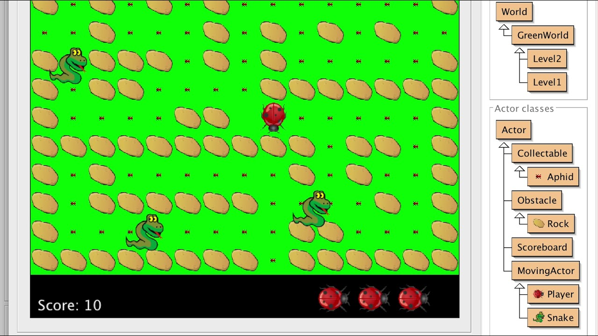
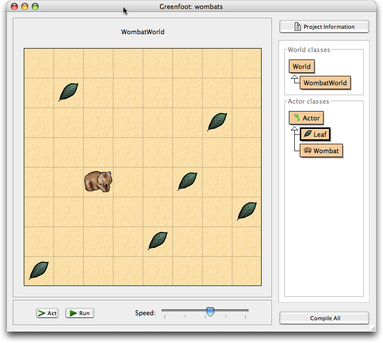

# Greenfoot Visual Java Programming for Interactive Learning

[](https://github.com/greenfoot-programming/greenfoot-IDE/releases/)

Greenfoot connects Java code with a visible world of objects, movement and interaction.
The greenfoot IDE provides a practical setting for exploring object-oriented ideas through small games and simulations.

Use greenfoot java projects to connect class definitions with objects you can observe.
Change a method, compile the scenario and compare what happens with your prediction.

## A Scenario as a Learning Model

A scenario gives a program a visible setting.
The world defines the environment, while actors represent objects that participate in it.

- Give each actor a clear responsibility.
- Keep world setup separate from repeated actor behavior.
- Use small changes to explore cause and effect.
- Discuss object state alongside visible movement.
- Build a simple interaction before adding presentation details.

This approach makes greenfoot programming useful for experimenting with conditions, methods and inheritance.
A moving object can become a concrete example of code that changes state over time.



## Choosing the Next Task

| Learning goal | Useful activity | Evidence to observe |
| --- | --- | --- |
| Understand objects | Place two actors from one class | Each object has its own position |
| Explore methods | Change one actor action | The visible behavior changes |
| Practice conditions | React to a held key | Movement depends on input |
| Understand constructors | Populate a new world | Initial objects appear when the world is created |
| Discuss inheritance | Extend Actor or World | A subclass uses inherited operations |
| Investigate a bug | Simplify the behavior | A smaller example reveals the cause |

Choose one learning question for each revision.
Add complexity after the previous behavior is understood.

## Actor Behavior

An actor's act method describes behavior performed during simulation steps.
Movement uses the actor's current direction, and turning changes that direction.

This example belongs in a Greenfoot scenario as a new Actor subclass.

```java
import greenfoot.*;
public class Rover extends Actor {
    public void act() {
        if (Greenfoot.isKeyDown("up")) {
            move(3);
        }
        if (Greenfoot.isKeyDown("right")) {
            turn(4);
        }
    }
}
```

Place a Rover in a world before running the scenario.
Hold Up to move and Right to turn; both conditions can be true during the same step.

Try changing one numeric value at a time.
Predict the result before running so the experiment tests a specific idea.

## World Construction

A World subclass establishes the dimensions and initial contents of a scenario.
The constructor's width and height are measured in cells, while the third argument specifies cell size in pixels.

Use this class with the Rover class above.

```java
import greenfoot.*;
public class PracticeWorld extends World {
    public PracticeWorld() {
        super(640, 400, 1);
        addObject(new Rover(), 320, 200);
    }
}
```

The example creates a 640 by 400 world with one-pixel cells.
It places one actor at a defined starting location.

The greenfoot API distinguishes world coordinates from an actor's facing direction.
Keep those ideas separate when explaining why an object moves or turns.

## Java and Stride Editing

Greenfoot supports Java and the frame-based Stride language.
Choose the editing approach that fits the exercise and the learner's experience.

Java exposes the textual form used in other Java environments.
Stride provides a structured editing approach that can support discussion of program construction.

The shared Stride library includes [Utility.java](lang-stride/src/main/java/lang/stride/Utility.java).
Terminal support for that library is implemented in [Terminal.java](lang-stride/src/main/java/lang/stride/Terminal.java).
Its module definition is [build.gradle](lang-stride/build.gradle).

These are supporting implementation files rather than the complete scenario API.
Read them in the context of the shared IDE repository.

## Building and Running from Source

IDE development requires a complete source checkout and a Java 21 JDK.
The following Bash example checks the Java tools and launches the Greenfoot development task.

```bash
java -version
javac -version
./gradlew runGreenfoot
```

The shell wrapper is [gradlew](gradlew), with [gradlew.bat](gradlew.bat) available for Windows.
The root [build.gradle](build.gradle) coordinates shared build configuration.
The included projects are declared in [settings.gradle](settings.gradle).

> [!NOTE]
> The selected files are only part of the shared source tree.
> Running the build requires the remaining modules and Gradle wrapper resources from the complete checkout.

Version fields are stored in [version.properties](version.properties).
Development source metadata and the latest published Greenfoot release should be checked separately.

## Packaging the IDE

Packaging uses platform-specific Gradle tasks.
Each command below is an independent choice for the corresponding target.

```bash
./gradlew packageGreenfootWindows
./gradlew packageGreenfootLinux
./gradlew packageGreenfootMacIntel
./gradlew packageGreenfootMacAarch
```

Set the required external tool paths in [tools.properties](tools.properties) before packaging.
Task availability does not mean every target can be packaged from every host.

Keep packaging work separate from ordinary scenario development.
A learner editing an actor class does not need to rebuild the Greenfoot application.

## Shared Startup Components

The source repository contains infrastructure used by both educational IDEs.
Some package and directory names therefore retain the BlueJ name.

The shared launcher is implemented in [Boot.java](boot/src/main/java/bluej/Boot.java).
Startup display code appears in [SplashWindow.java](boot/src/main/java/bluej/SplashWindow.java).
The image-generation helper [DrawVersionOnSplash.java](boot/src/splash/java/DrawVersionOnSplash.java) draws version text onto a splash image.
The startup module is configured by [build.gradle](boot/build.gradle).

When investigating startup behavior, distinguish launcher work from scenario execution.
An actor's act method belongs to a different part of the application lifecycle.



## Thread Annotations in the IDE Source

The IDE source uses annotations to describe expected thread contexts.
These support implementation checks and are separate from the basic Actor and World teaching model.

The annotation declaration is [OnThread.java](anns-threadchecker/src/main/java/threadchecker/OnThread.java).
Thread categories are defined in [Tag.java](anns-threadchecker/src/main/java/threadchecker/Tag.java).
Associated context information is represented by [LocatedTag.java](anns-threadchecker/src/main/java/threadchecker/LocatedTag.java).

A beginner scenario can focus on its own methods without using these internal annotations.
Contributors changing shared UI code should understand the surrounding thread expectations.

## Developing a Small Game Exercise

Build greenfoot games around one visible rule before adding scores, levels or sound.
For example, begin with controlled movement, then introduce a target or obstacle.

- State the rule in plain language.
- Identify which object owns the relevant information.
- Implement the smallest behavior that demonstrates the rule.
- Check normal input and edge positions.
- Explain the result using the code that produced it.

Keep a short record of the behavior you expected and what you observed.
That record makes debugging a discussion about evidence rather than repeated guessing.

## Related Search Terms

greenfoot IDE, greenfoot java, greenfoot programming, greenfoot API, greenfoot games, java, education, learning, ide, learning-programming, creative-coding, game-development, 2d-game, open-source
